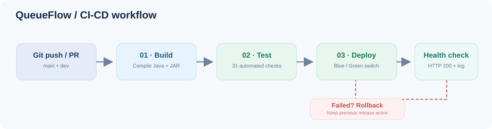
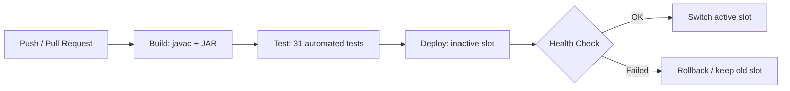
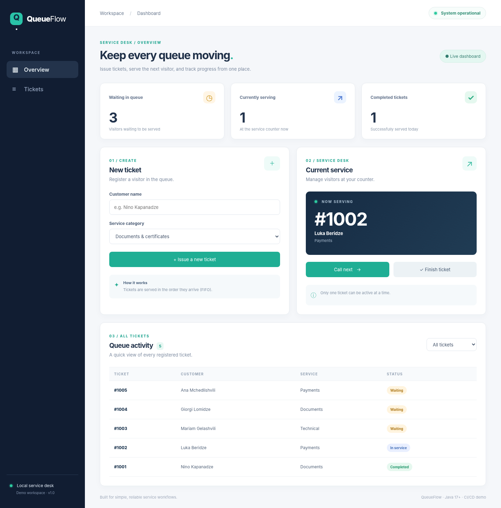
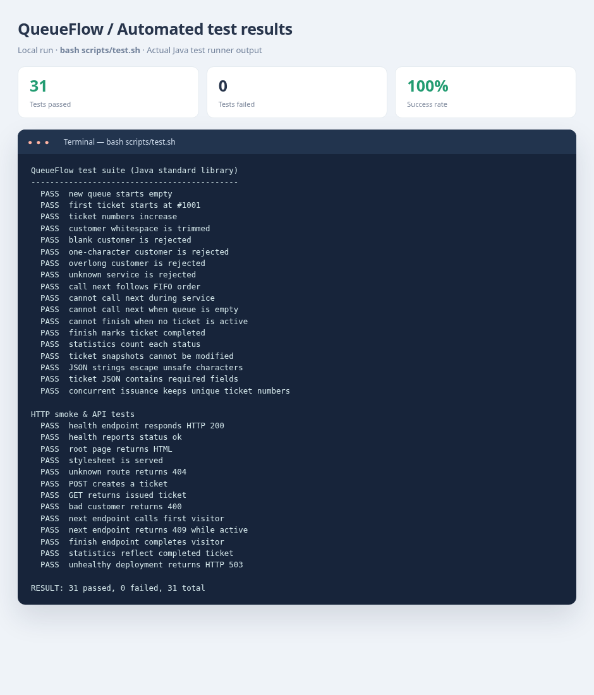
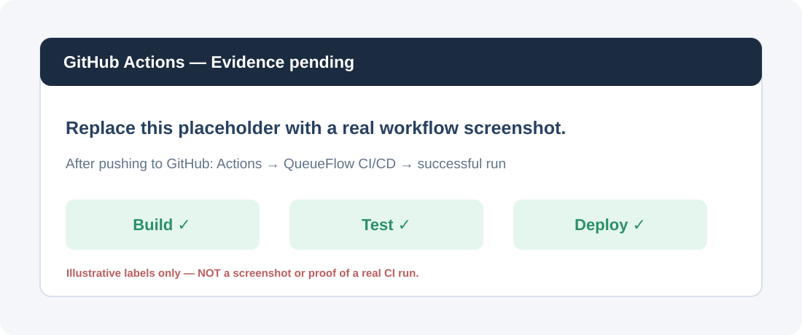
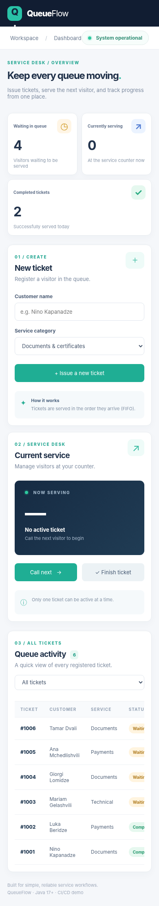

# QueueFlow — Service Queue Management

**DevOps შუალედური პროექტი | Java 17+, HTML, CSS, JavaScript, Bash, GitHub Actions**

QueueFlow არის პატარა ვებაპლიკაცია მომსახურების ცენტრის რიგის მართვისთვის. მომხმარებელს შეუძლია ბილეთის აღება, ოპერატორს კი — მომდევნო ვიზიტორის გამოძახება და მომსახურების დასრულება. დაფაზე რეალურ დროში ჩანს მოლოდინში მყოფი, მომსახურების პროცესში მყოფი და დასრულებული ბილეთების რაოდენობა.

ამ პროექტის მთავარი ნაწილია **Build → Test → Deploy** ავტომატიზაცია, Health Check, `.log` ფაილში სტატუსების ჩაწერა და **Blue–Green + Rollback** სტრატეგია.

## 1. აპლიკაციის შესაძლებლობები

- ახალი ბილეთის შექმნა (`#1001`, `#1002`, ...), მომხმარებლის სახელით და მომსახურების ტიპით;
- რიგიდან შემდეგი ბილეთის გამოძახება **FIFO** პრინციპით;
- ერთდროულად მხოლოდ ერთი აქტიური მომსახურება;
- ბილეთის დასრულება და სტატისტიკის ავტომატური განახლება;
- ყველა ბილეთის ნახვა და სტატუსით გაფილტვრა;
- სისტემის მუშაობის სტატუსის ჩვენება (`GET /api/health`).

გამოყენებულია **Java-ს სტანდარტული HTTP სერვერი** (`com.sun.net.httpserver.HttpServer`), HTML, CSS და Vanilla JavaScript. გარე ბიბლიოთეკები არ სჭირდება. ტესტებიც დამოუკიდებელი Java test runner-ით მუშაობს. ეს არჩევანი განზრახ გაკეთდა, რომ CI მარტივი, გამჭვირვალე და სწრაფი იყოს.

> მონაცემები ამ სასწავლო ვერსიაში **მეხსიერებაში** ინახება. სერვერის გადატვირთვა რიგს თავიდან იწყებს. აქ ყურადღება გამახვილებულია DevOps პროცესზე და არა მუდმივ მონაცემთა ბაზაზე. აპლიკაცია დემოა და არ არის განკუთვნილი საჯარო მომხმარებლების მონაცემებისთვის ან რეალური წარმოებისთვის.

## 2. პროექტის გაშვება ლოკალურად

საჭიროა **Java JDK 17 ან უფრო ახალი**, Git Bash / Linux / macOS-ის Bash და `curl`.

```bash
# 1. კომპილაცია და გამზადებული JAR
bash scripts/build.sh

# 2. ავტომატური ტესტები
bash scripts/test.sh

# 3. სერვერის გაშვება
java -jar build/queueflow.jar --port 8080
```

ბრაუზერში გახსენით **http://localhost:8080**. სერვერის გასაჩერებლად გამოიყენეთ `Ctrl + C`.

ჯანმრთელობის შემოწმება სხვა ტერმინალიდან:

```bash
curl http://localhost:8080/api/health
# {"status":"ok","service":"QueueFlow"}
```

## 3. Git და ბრენჩები

რეპოზიტორიაში გვაქვს ორი ბრენჩი — `main` და `dev`. ცვლილებების შეტყობინებები მოკლე და შინაარსიანია (`feat`, `test`, `ci`, `docs`). სამუშაო მიმდინარეობა: განვითარება `dev`-ზე → შემოწმება → გადატანა `main`-ში.

სხვა GitHub ანგარიშზე ასატვირთად შექმენით **ცარიელი public repository** `QueueFlow-DevOps` (არ დაამატოთ GitHub-იდან ახალი README/`.gitignore`), შემდეგ უკვე გაშლილი პროექტის საქაღალდეში:

```bash
git remote add origin https://github.com/YOUR_USERNAME/QueueFlow-DevOps.git
git push -u origin main
git push -u origin dev
```

თუ `origin` უკვე არსებობს: `git remote set-url origin https://github.com/YOUR_USERNAME/QueueFlow-DevOps.git`.

## 4. CI/CD Pipeline — სამი ძირითადი Job

კონფიგურაცია: **`.github/workflows/ci-cd.yml`**. Pipeline ავტომატურად იწყება `main`/`dev` ბრენჩზე ყოველი **push**-ისა და **Pull Request**-ისას. ასევე აქვს ხელით გაშვების (`workflow_dispatch`) შესაძლებლობა.

| Job | რას აკეთებს | წარუმატებლობის შედეგი |
|---|---|---|
| **Build** | GitHub runner-ზე აყენებს JDK 21-ს, `javac`-ით აკომპილირებს Java კოდს, ქმნის `queueflow.jar`-ს და ატვირთავს Artifacts-ში | შემდეგი Job არ გაეშვება |
| **Test** | იღებს იმავე JAR-ს და უშვებს **31 Unit/API ტესტს** (`bash scripts/test.sh`) | Deploy არ გაეშვება |
| **Deploy** | ტესტირებულ JAR-ს ათავსებს ლოკალურ `production/blue` ან `production/green` საქაღალდეში, უშვებს სერვერს, ამოწმებს `/api/health`-ს, ცვლის აქტიურ ვერსიას და ამოწმებს Rollback-ს | Job წარუმატებლად დასრულდება |

**მნიშვნელოვანი გარემოს შეზღუდვა:** GitHub-hosted runner-ზე `production/` საქაღალდე არსებობს მხოლოდ იმ Job-ის შესრულების განმავლობაში. ეს არის დავალების **ლოკალური Deployment (გზა ა)** დემონსტრაცია და არა საჯარო ინტერნეტში მუდმივი ჰოსტინგი. მუდმივი სერვერისთვის გამოიყენება საკუთარი მანქანა/VM და self-hosted runner. GitHub Actions-ში ბოლო Deploy Job ასევე ინახავს Monitoring-ის ლოგებს `deployment-logs` Artifact-ის სახით.

## 5. ლოკალური Blue–Green Deploy და Rollback

```bash
bash scripts/build.sh
bash scripts/deploy.sh        # პირველად: blue (პორტი 18180)
bash scripts/monitor.sh --once

bash scripts/deploy.sh        # შემდეგ: green (პორტი 18181)
bash scripts/monitor.sh --once
```

სკრიპტი ახალ ვერსიას თავიდან **არააქტიურ** საქაღალდეში დებს. სანამ ახალი სერვერის Health Check არ დააბრუნებს **HTTP 200** და `"status":"ok"`, მიმდინარე ვერსია უცვლელია. წარმატების შემთხვევაში `production/current` symlink ატომურად გადადის ახალ საქაღალდეზე და ძველი სერვერი ჩერდება.

Rollback-ის რეალური შემოწმება (ეს ბრძანება **განზრახ** უნდა დასრულდეს შეცდომით):

```bash
INJECT_FAILURE=1 CHECK_ATTEMPTS=3 bash scripts/deploy.sh
```

ტესტურ რეჟიმში ახალი სერვერი `/api/health`-ზე აბრუნებს **HTTP 503**-ს. Deployment უარყოფილია, `production/current` ძველ ჯანმრთელ ვერსიაზე რჩება და ლოგში იწერება `ROLLBACK`.

```bash
cat production/active.env
cat production/monitoring.log
bash scripts/stop.sh          # გაშვებული ლოკალური პროცესების შეჩერება
```

## 6. მონიტორინგი

სკრიპტი: `scripts/health-check.sh`, რომელიც გამოიყენება Deploy-ში და ცალკე მონიტორინგშიც.

```bash
bash scripts/monitor.sh --once      # ერთჯერადი შემოწმება
bash scripts/monitor.sh --watch     # პერიოდული შემოწმება, ყოველ 15 წამში
```

მონიტორინგი ამოწმებს `GET /api/health` URL-ს, ამოწმებს HTTP სტატუსსა და JSON პასუხს და შედეგს წერს `production/monitoring.log` ფაილში. მაგალითი რეალური ლოკალური გაშვებიდან: [`docs/monitoring-example.log`](docs/monitoring-example.log). ყველა GitHub Actions Deploy-ისას ლოგები ასევე ინახება Artifacts-ში.

## 7. Workflow diagram



იგივე დიაგრამის რედაქტირებადი Mermaid წყარო: [`docs/workflow.mmd`](docs/workflow.mmd).



## 8. სქრინშოტები და მტკიცებულებები

### A. მომუშავე აპლიკაცია — ლოკალური გაშვება

ქვემოთ ჩანს Java სერვერთან დაკავშირებული აპლიკაცია: რეგისტრირებული ბილეთები, მოლოდინის რაოდენობა, აქტიური ბილეთი და დასრულებული მომსახურება.



### B. Unit Test-ების გაშვება

ლოკალურად გაშვებული `bash scripts/test.sh` ბრძანების რეალური შედეგი: **31 passed, 0 failed**. სურათი აჩვენებს ტესტების ტექსტურ შედეგს.



### C. GitHub Actions — საბოლოოდ დასამატებელი სქრინშოტი

**ეს ჯერ რეალური GitHub Actions-ის სქრინშოტი არ არის.** GitHub-ზე რეპოზიტორიის ატვირთვის შემდეგ გახსენით **Actions → QueueFlow CI/CD → წარმატებული Run**, გადაიღეთ ერთი სქრინი, სადაც ჩანს სამივე მწვანე Job (**Build, Test, Deploy**), და შეინახეთ `docs/screenshots/actions-success.png` სახელით.

**სანამ სქრინს არ დაამატებთ, ეს მოთხოვნა ბოლომდე შესრულებული არ არის.** ქვემოთ მხოლოდ ადგილმონაცვლეა:



ახალი სურათის დამატების შემდეგ შეცვალეთ წინა Markdown ხაზი ასეთით:

```markdown

```

და ატვირთეთ:

```bash
git add README.md docs/screenshots/actions-success.png
git commit -m "docs: add successful GitHub Actions screenshot"
git push origin main
```

### D. მობილური ვერსია (დამატებითი)



## 9. API და კოდის ორგანიზაცია

| მისამართი | მეთოდი | დანიშნულება |
|---|---|---|
| `/` | GET | ვებინტერფეისი |
| `/api/health` | GET | Health Check |
| `/api/stats` | GET | რაოდენობები სტატუსებით |
| `/api/tickets` | GET | ყველა ბილეთი |
| `/api/tickets` | POST | ბილეთის შექმნა (`customer`, `service`) |
| `/api/next` | POST | შემდეგი ვიზიტორი |
| `/api/finish` | POST | აქტიური ვიზიტორის დასრულება |

- `src/main/java/queueflow/` — მონაცემთა მოდელი, ბიზნესლოგიკა, HTTP სერვერი;
- `src/main/resources/public/` — HTML/CSS/JavaScript ინტერფეისი;
- `src/test/java/queueflow/TestSuite.java` — Unit/API ტესტები;
- `scripts/` — Build, Test, Deploy, Monitor, Stop და Health Check;
- `.github/workflows/ci-cd.yml` — GitHub Actions;
- `docs/` — სამუშაო დიაგრამა, სქრინშოტები და მონიტორინგის მაგალითი.

## 10. ჩაბარებამდე შემოწმება

- [ ] რეპოზიტორია **Public** რეჟიმშია და აქვს `main` და `dev`;
- [ ] Actions-ში **Build → Test → Deploy** რეალურად წარმატებულია;
- [ ] README-ში სამივე **რეალური** სქრინშოტია (Pipeline, Tests, App);
- [ ] Workflow diagram და Monitoring-ის აღწერა README-ში ჩანს;
- [ ] Commit-ები გაკეთებულია **03.11.2026, 23:59-მდე**;
- [ ] სასწავლო სისტემაში ატვირთულია მხოლოდ რეპოზიტორიის URL.

---

*ეს არის სასწავლო DevOps პროექტი, რომელიც აჩვენებს სრულ CI/CD პროცესს ლოკალური Deployment სტრატეგიით.*
